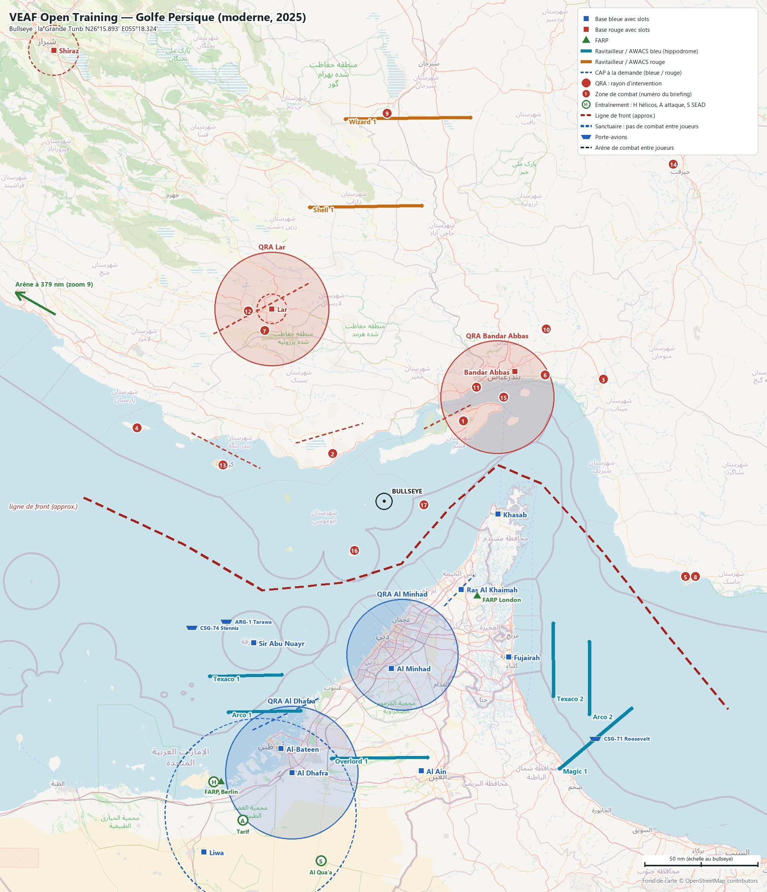
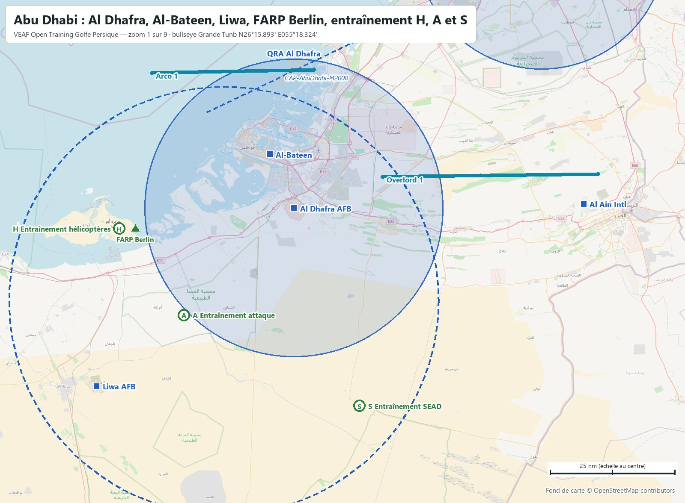
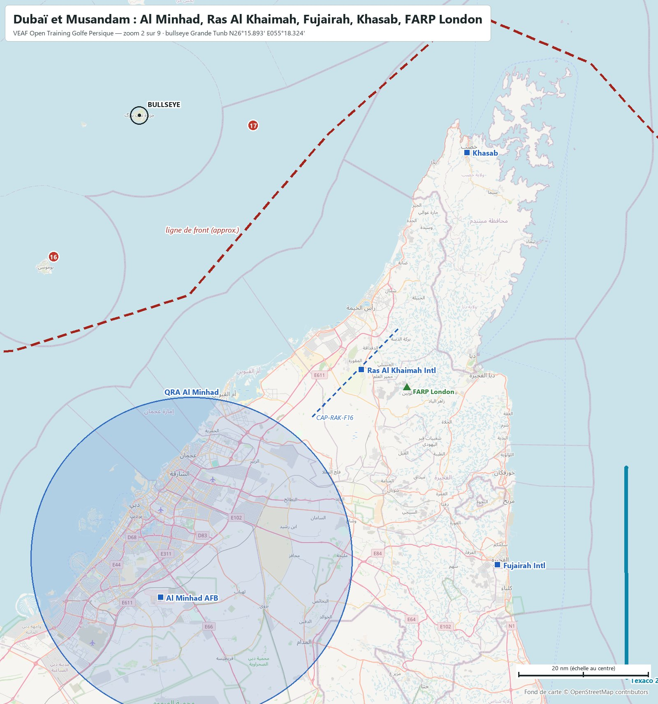
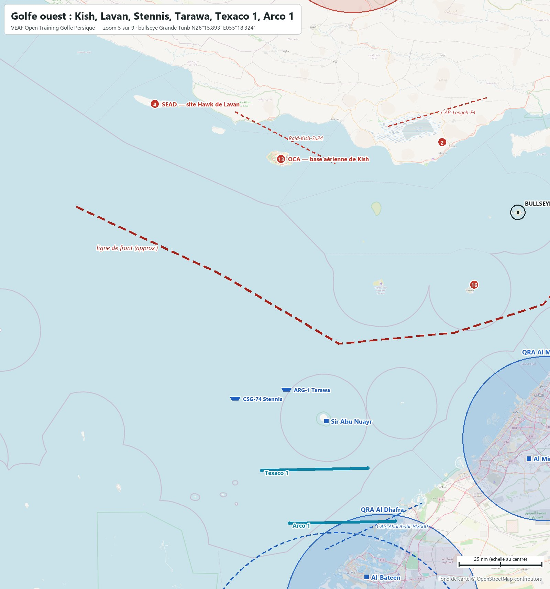
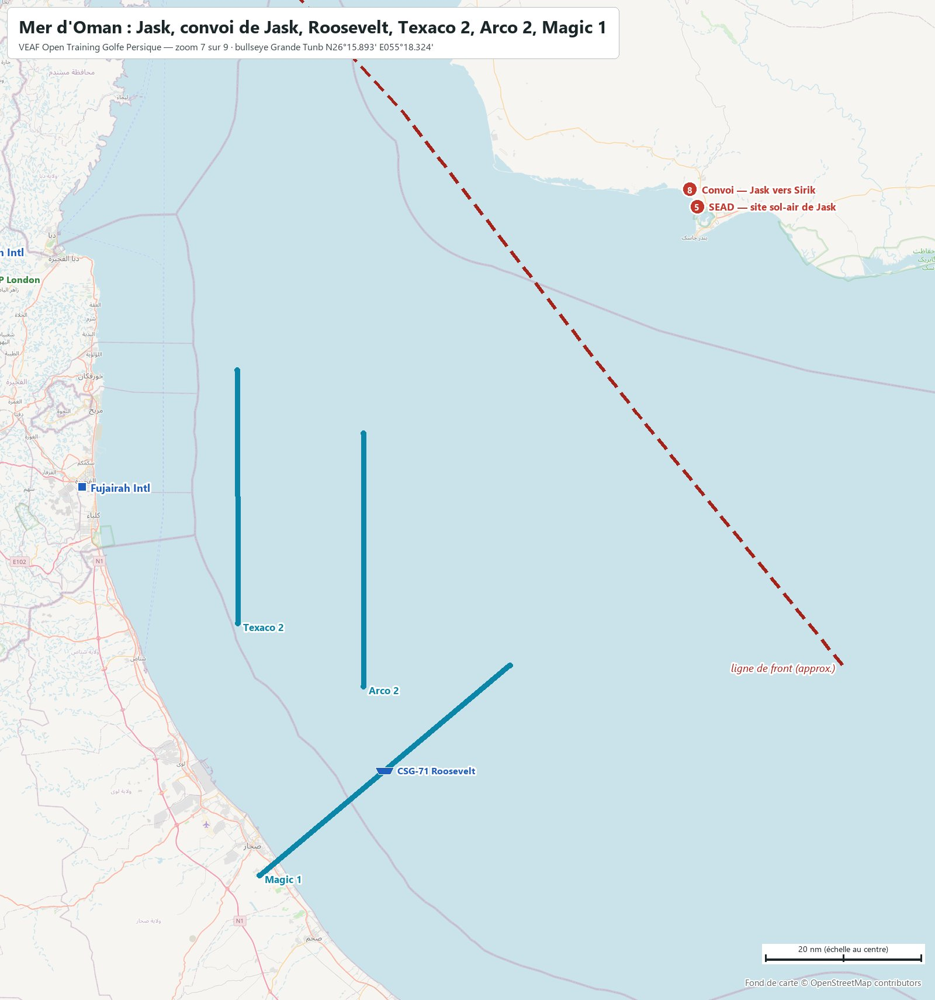
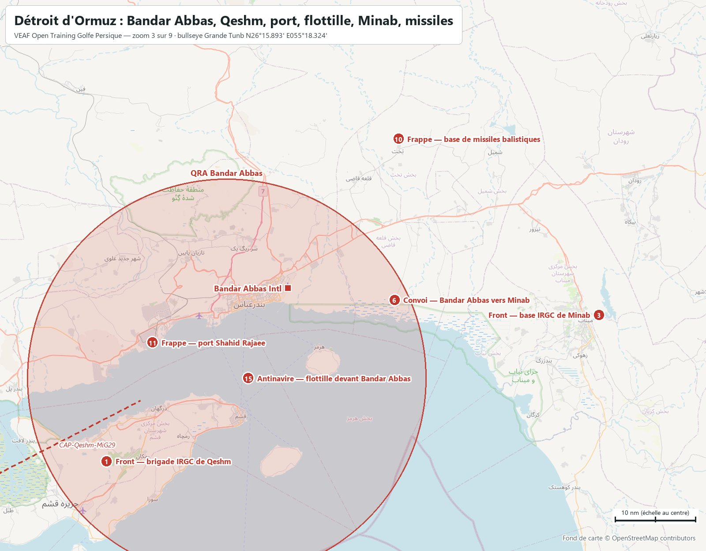
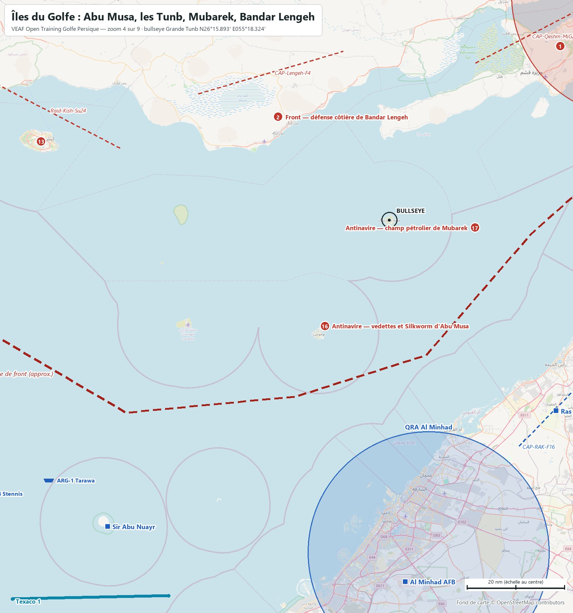
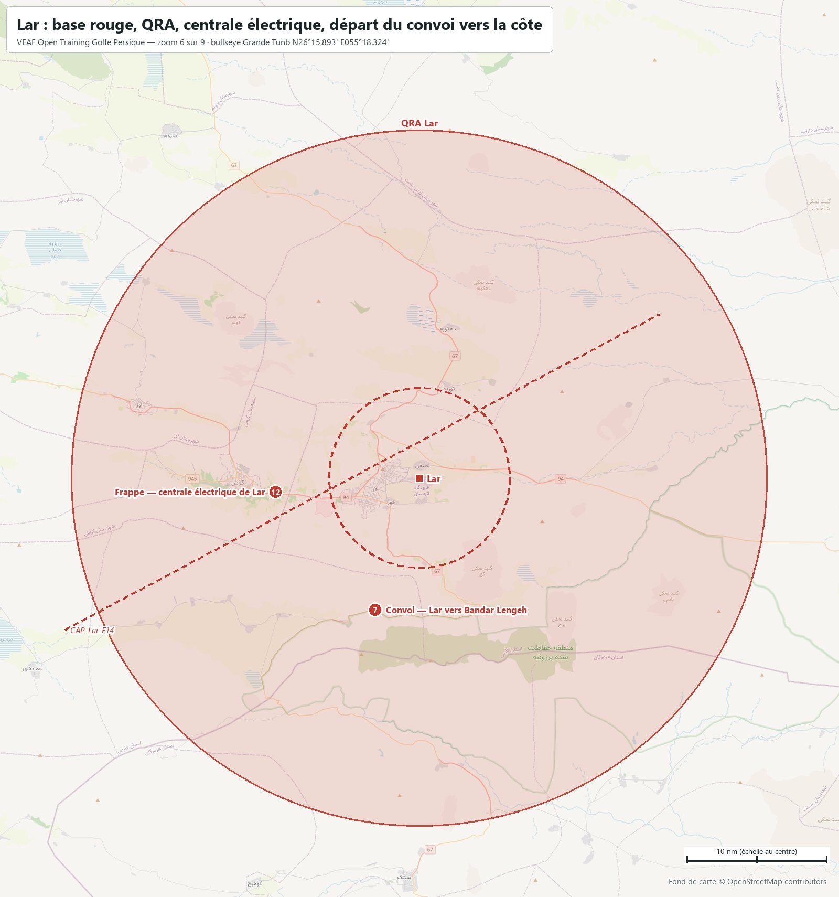
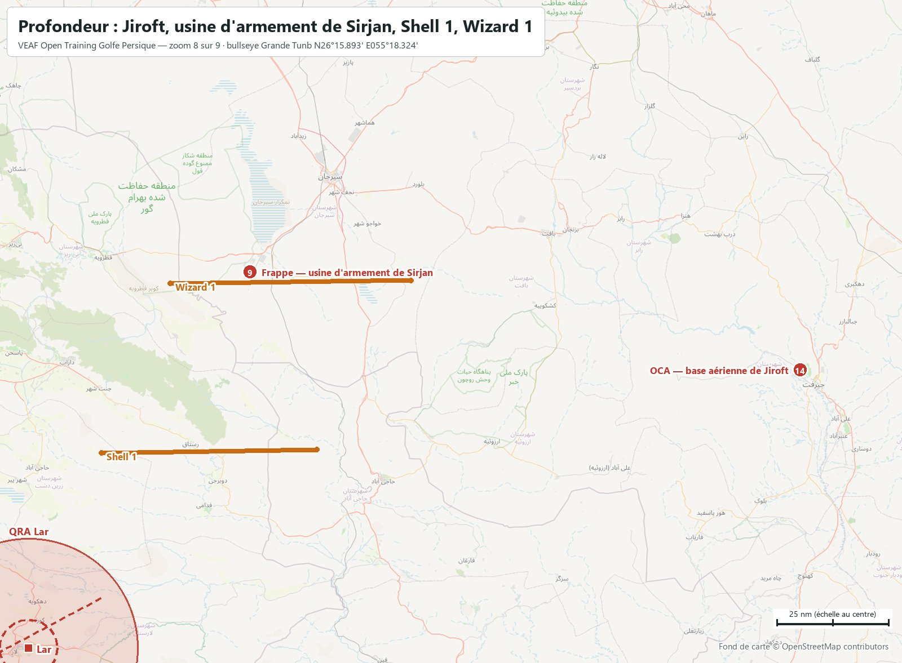
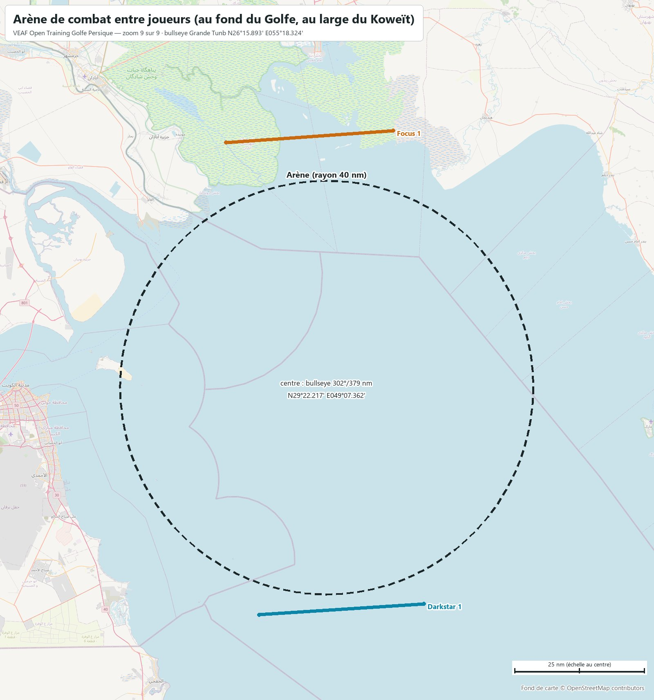

# VEAF Open Training — Golfe Persique (moderne, 2025)

Mission d'entraînement ouverte des serveurs VEAF, sur la carte **Persian Gulf** de DCS, dans un scénario moderne. Ce document est le briefing complet : bases, soutien, zones, QRA, CAP, radio, météo. Les positions sont données en coordonnées (degrés, minutes décimales) et en relèvement/distance depuis le bullseye (relèvement vrai, nautiques).

| Mission | Date | Heure de base | Bullseye (bleu et rouge) | Météo | ATC |
|---|---|---|---|---|---|
| `VEAF_OpenTraining_PersianGulf_ICAO_OMAA` | 15/11/2025 | 09:00 (heure de la carte, UTC+4) | la Grande Tunb · `N26°15.893' E055°18.324'` | celle du serveur VEAF | coupé sur tous les aérodromes |

**Sommaire** : [Situation](#situation) · [Carte](#carte) · [Bases](#bases) · [Ravitailleurs et AWACS](#ravitailleurs-et-awacs) · [Porte-avions](#porte-avions) · [Drones laser](#drones-laser) · [Entraînement](#entraînement) · [Zones de combat](#zones-de-combat) · [Missions scénarisées](#missions-scénarisées) · [QRA](#qra) · [CAP à la demande](#cap-à-la-demande) · [Combat entre joueurs](#combat-entre-joueurs) · [Défense aérienne](#défense-aérienne) · [Plan radio](#plan-radio) · [Météo et heures](#météo-et-heures) · [Commandes utiles](#commandes-utiles) · [Pour les créateurs de mission](#pour-les-créateurs-de-mission)

## Situation

L'Iran ferme le détroit d'Ormuz. Une coalition tient la rive sud : les Émirats arabes unis, Oman (avec l'enclave de Musandam et sa base de Khasab, au bord du détroit) et les États-Unis, avec trois groupes aéronavals — le Stennis et le Tarawa dans le Golfe, le Roosevelt en mer d'Oman. L'Iran tient la rive nord et les îles du Golfe : Lavan, Kish, Sirri, Abu Musa et les Tunb. Le front est le Golfe lui-même, environ 290 nm de mer de Lavan à Jask ; Khasab est à 63 nm de Bandar Abbas, Al Dhafra à 200 nm. Le bullseye commun est la Grande Tunb, au milieu du front.

Zones de combat, missions et soutien se pilotent par le menu radio F10 (*Zones de combat*, *Missions de combat*, *Assets*).

## Carte



Cartes zoomées, reprises dans les sections qu'elles illustrent : [Abu Dhabi](docs/cartes/carte_01_abudhabi.jpg) · [Dubaï et Musandam](docs/cartes/carte_02_dubai.jpg) · [Détroit d'Ormuz](docs/cartes/carte_03_ormuz.jpg) · [Îles du Golfe](docs/cartes/carte_04_iles.jpg) · [Golfe ouest](docs/cartes/carte_05_ouest.jpg) · [Lar](docs/cartes/carte_06_lar.jpg) · [Mer d'Oman](docs/cartes/carte_07_oman.jpg) · [Profondeur](docs/cartes/carte_08_profondeur.jpg) · [Arène de combat entre joueurs (au fond du Golfe, au large du Koweït)](docs/cartes/carte_09_arene.jpg).

Carrés : bases avec slots (bleu / rouge). Triangles : FARP. Traits pleins : hippodromes des ravitailleurs et AWACS. Pointillés : CAP à la demande. Cercles pleins : QRA. Pastilles vertes : entraînement (H hélicoptères, A attaque, S SEAD). Pastilles rouges numérotées : zones de combat. Cercles en tirets : sanctuaires. Navires : porte-avions et LHA. La flèche verte en bordure montre l'arène, loin au nord-ouest au fond du Golfe (zoom 9). Fond OpenStreetMap ; la ligne de front est approximative. Le briefing DCS montre cette carte puis les zooms (flèches sous l'image, molette pour grossir) ; la carte F10 porte les mêmes dessins : front, zones, QRA, sanctuaires et arène pour les deux camps, hippodromes de soutien pour leur camp seulement.

## Bases

| Base | Camp | Position | Bullseye | UHF | VHF | FM | Défense |
|---|---|---|---|---|---|---|---|
| **Al Ain Intl** | Bleu | `N24°15.686' E055°36.555'` | `173°/121 nm` | `250.7` | `119.85` | `39.15` | Patriot + Avenger |
| **Al Dhafra AFB** (base mère) | Bleu | `N24°14.897' E054°32.862'` | `200°/127 nm` | `251.1` | `126.5` | `39.5` | Patriot + Hawk + Avenger |
| **Al Minhad AFB** | Bleu | `N25°01.613' E055°21.946'` | `178°/74 nm` | `250.1` | `118.55` | `38.5` | Patriot + Avenger |
| **Al-Bateen** | Bleu | `N24°25.684' E054°27.515'` | `204°/119 nm` | `250.6` | `119.9` | `39.05` | NASAMS + Avenger |
| **Fujairah Intl** | Bleu | `N25°06.656' E056°19.641'` | `142°/88 nm` | `251.25` | `124.6` | `39.65` | Hawk + Avenger |
| **Khasab** | Bleu | `N26°10.189' E056°14.410'` | `097°/51 nm` | `250.0` | `124.35` | `38.4` | Hawk + Avenger |
| **Liwa AFB** | Bleu | `N23°39.046' E053°49.466'` | `208°/176 nm` | `250.95` | `119.3` | `39.35` | Hawk + Avenger |
| **Ras Al Khaimah Intl** | Bleu | `N25°36.809' E055°56.328'` | `139°/52 nm` | `250.9` | `121.6` | `39.3` | NASAMS + Avenger |
| **Sir Abu Nuayr** | Bleu | `N25°13.012' E054°14.019'` | `224°/85 nm` | `250.8` | `118.0` | `38.7` | NASAMS |
| **Bandar Abbas Intl** | Rouge | `N27°13.061' E056°22.738'` | `046°/81 nm` | `251.0` | `118.1` | `39.4` | SA-11 + Hawk + SA-15 |
| **Lar** | Rouge | `N27°40.484' E054°22.988'` | `331°/98 nm` | `250.05` | `127.35` | `38.45` | SA-10 + SA-15 |
| **Shiraz Intl** | Rouge | `N29°32.455' E052°35.465'` | `325°/244 nm` | `250.35` | `121.9` | `38.8` | SA-11 + SA-15 + Radar d'alerte 55G6 |
| **FARP Berlin** | Bleu | `N24°10.823' E053°57.962'` | `211°/144 nm` | — | — | `127.5` | dépôt de munitions (CTLD) |
| **FARP London** | Bleu | `N25°34.090' E056°04.140'` | `136°/59 nm` | — | — | `128.5` | dépôt de munitions (CTLD) |

Slots dynamiques, démarrage moteur chaud, carburant et munitions illimités. Les autres aérodromes de chaque camp lui appartiennent, sans slots : côté bleu les grands aéroports civils (Abu Dhabi, Dubaï, Sharjah, Al Maktoum, Sas Al Nakheel) ; côté rouge tous les autres terrains iraniens, dont Havadarya, Qeshm, Kish et les îles. Quasoura, dans le sud d'Oman, est neutre. Fréquences : celles que DCS donne à chaque tour (ATC coupé).

<table><tr><td width="50%"><a href="docs/cartes/carte_01_abudhabi.jpg"></a><br><sub>Abu Dhabi : Al Dhafra, Al-Bateen, Liwa, FARP Berlin, entraînement H, A et S</sub></td><td width="50%"><a href="docs/cartes/carte_02_dubai.jpg"></a><br><sub>Dubaï et Musandam : Al Minhad, Ras Al Khaimah, Fujairah, Khasab, FARP London</sub></td></tr></table>

## Ravitailleurs et AWACS

| Indicatif | Camp | Appareil | Rôle | UHF | TACAN | Niveau | Bullseye (milieu) | Hippodrome (extrémités) | Escorte |
|---|---|---|---|---|---|---|---|---|---|
| **Texaco 1** | Bleu | KC-135 | perche · ouest | `290.0` | `50Y` | `FL220` | `220°/99 nm` | `N24°58.020' E053°52.365'`<br>`N24°58.698' E054°27.989'` | oui |
| **Arco 1** | Bleu | KC135MPRS | panier · ouest | `291.0` | `51Y` | `FL180` | `211°/107 nm` | `N24°41.968' E054°01.657'`<br>`N24°42.603' E054°37.209'` | oui |
| **Overlord 1** | Bleu | E-3A | AWACS · ouest | `282.0` | — | `FL300` | `182°/114 nm` | `N24°21.165' E054°52.393'`<br>`N24°21.705' E055°39.695'` | oui |
| **Texaco 2** | Bleu | KC-135 | perche · est | `292.0` | `52Y` | `FL240` | `133°/103 nm` | `N24°49.136' E056°41.739'`<br>`N25°21.647' E056°41.659'` | oui |
| **Arco 2** | Bleu | KC135MPRS | panier · est | `293.0` | `53Y` | `FL200` | `131°/120 nm` | `N24°41.026' E056°59.552'`<br>`N25°13.538' E056°59.550'` | oui |
| **Magic 1** | Bleu | E-2C | AWACS · est | `283.0` | — | `FL280` | `139°/141 nm` | `N24°16.628' E056°44.774'`<br>`N24°43.713' E057°20.317'` | oui |
| **Darkstar 1** | Bleu | E-3A | AWACS · arène | `285.0` | — | `FL300` | `296°/358 nm` | `N28°40.341' E049°28.883'`<br>`N28°38.220' E048°52.388'` | non |
| **Wizard 1** | Rouge | A-50 | AWACS rouge | `284.0` | — | `FL300` | `004°/167 nm` | `N29°02.859' E054°59.369'`<br>`N29°03.546' E056°00.981'` | oui |
| **Focus 1** | Rouge | A-50 | AWACS rouge · arène | `286.0` | — | `FL300` | `308°/406 nm` | `N30°11.593' E049°22.070'`<br>`N30°09.337' E048°45.038'` | non |
| **Shell 1** | Rouge | IL-78M | ravitailleur rouge | `294.0` | — | `FL200` | `357°/129 nm` | `N28°24.682' E054°41.727'`<br>`N28°25.429' E055°36.834'` | oui |

Les ravitailleurs et AWACS du théâtre sont escortés (paires de F-15C ; MiG-29A et F-14A côté rouge). Marqueurs F10 : `-tanker <nom>` amène un ravitailleur au marqueur ; `-tankerlow` et `-tankerhigh` mettent le plus proche au FL120 ou au FL220.

## Porte-avions

| Navire | Position de départ | Bullseye | TACAN | ICLS | Link 4 | Tour | Slots sur le pont |
|---|---|---|---|---|---|---|---|
| **CSG-74 Stennis** (CSG-74 Stennis, 2 escorteurs) | `N25°19.860' E053°43.528'` | `238°/102 nm` | `74X STN` | `11` | `336.0` | `305.0` | 2 × F/A-18C, 2 × F/A-18C, 2 × F-14B |
| **CSG-71 Roosevelt** (CSG-71 Roosevelt, 2 escorteurs) | `N24°30.188' E057°02.513'` | `139°/141 nm` | `71X RSV` | `12` | `337.0` | `306.0` | 2 × F/A-18C, 2 × F-14B, 2 × F-14B |
| **ARG-1 Tarawa** (ARG-1 Tarawa, 1 escorteur) | `N25°22.553' E054°00.675'` | `234°/88 nm` | `73X TRW` | `13` | — | `307.0` | 2 × AV-8B, 2 × AV-8B |

<table><tr><td width="50%"><a href="docs/cartes/carte_05_ouest.jpg"></a><br><sub>Golfe ouest : Kish, Lavan, Stennis, Tarawa, Texaco 1, Arco 1</sub></td><td width="50%"><a href="docs/cartes/carte_07_oman.jpg"></a><br><sub>Mer d'Oman : Jask, convoi de Jask, Roosevelt, Texaco 2, Arco 2, Magic 1</sub></td></tr></table>

Le Stennis et le Tarawa dans le Golfe, au nord-ouest de Sir Abu Nuayr ; le Roosevelt en mer d'Oman, au large de Fujairah. Slots à froid et à chaud sur les ponts, plus les slots dynamiques. Le menu F10 *CARRIER OPS* met chaque porte-avions face au vent, avec son ravitailleur S-3B (Stennis 56Y U296.0, Roosevelt 57Y U297.0) et son hélicoptère de sauvetage.

## Drones laser

| Drone | Appareil | Au-dessus de | Code laser | Radio | Hauteur | Bullseye |
|---|---|---|---|---|---|---|
| **Reaper 1** | MQ-9 Reaper | champ de tir de Tarif | `1511` | `35.55 FM` | `3 000 m sol` | `205°/156 nm` |
| **Reaper 2** | MQ-9 Reaper | Bandar Lengeh | `1512` | `35.6 FM` | `3 000 m sol` | `314°/31 nm` |

Reaper 1 tourne au-dessus du champ de tir d'attaque de Tarif, Reaper 2 au-dessus de la défense côtière de Bandar Lengeh (Z02), et chacun désigne au laser ce qu'il voit. CTLD le maintient à 3 000 m sol : l'artillerie antiaérienne de la zone peut l'abattre, et le menu F10 *Assets* le remet en vol. Il ne désigne que des véhicules — ce que sont aussi les cibles des niveaux faciles — et ne marque qu'à 10 km. Pas de drone sur une zone dont les SAM portent plus loin que le laser.

## Entraînement

Loin du front, à quelques minutes d'une base. Trois niveaux par famille, chacun comprenant ceux d'en dessous. **Activez un seul niveau par famille à la fois.** Les cibles des niveaux faciles sont des véhicules immobiles, en tir interdit : chauds au pod, inertes.


### Hélicoptères — Berlin (île d'Abu al Abyad, près du FARP Berlin)

`N24°10.751' E053°54.423'` · bullseye `212°/146 nm` · rayon 1.3 nm · menu F10 « Entraînement hélicoptères » · Arco 1 (panier, TACAN 51Y, 291.0) à 32 nm ; Texaco 1 (perche, TACAN 50Y, 290.0) à 47 nm

- **H1 Hélico Berlin — facile** — Champ de tir hélicoptères à 3 nm à l'ouest du FARP Berlin : cibles inertes (chars, blindés et camions immobiles, tir interdit).
- **H2 Hélico Berlin — moyen** — Champ de tir hélicoptères de Berlin : de l'artillerie antiaérienne légère (ZU-23, parfois un Shilka) en plus des cibles du niveau facile.
- **H3 Hélico Berlin — difficile** — Champ de tir hélicoptères de Berlin, avec une défense courte portée réaliste : un SA-13 et une équipe de lance-missiles portatifs SA-18, à guidage infrarouge.

### Attaque — Tarif (désert au nord de Liwa)

`N23°53.372' E054°08.675'` · bullseye `205°/156 nm` · rayon 1.3 nm · menu F10 « Entraînement attaque » · Arco 1 (panier, TACAN 51Y, 291.0) à 49 nm ; Texaco 1 (perche, TACAN 50Y, 290.0) à 65 nm

- **A1 Attaque Tarif — facile** — Champ de tir air-sol au nord de Tarif, à 23 nm de Liwa : blindés et camions immobiles en tir interdit, dépôt de carburant et poste de commandement. Le drone Reaper 1 tourne au-dessus.
- **A2 Attaque Tarif — moyen** — Champ de tir de Tarif : une compagnie blindée active et de l'artillerie antiaérienne légère en plus des cibles du niveau facile.
- **A3 Attaque Tarif — difficile** — Champ de tir de Tarif : un second groupe blindé et une défense courte portée à guidage infrarouge (SA-13 ou SA-9), avec un Shilka.

### SEAD — Al Qua'a (désert au sud d'Al Dhafra)

`N23°35.050' E054°47.271'` · bullseye `191°/163 nm` · rayon 1.6 nm · menu F10 « Entraînement SEAD » · Arco 1 (panier, TACAN 51Y, 291.0) à 68 nm ; Texaco 1 (perche, TACAN 50Y, 290.0) à 85 nm

- **S1 SEAD Al Qua'a — facile** — Site SEAD dans le désert d'Al Qua'a, au sud d'Al Dhafra : une batterie sol-air moyenne portée, SA-6 ou SA-11 tirée au sort.
- **S2 SEAD Al Qua'a — moyen** — Site SEAD d'Al Qua'a : la batterie moyenne portée est protégée par une défense courte portée (SA-15, SA-8).
- **S3 SEAD Al Qua'a — difficile** — Site SEAD d'Al Qua'a en réseau Skynet : un radar d'alerte avancée guide les batteries, qui restent éteintes jusqu'au dernier moment.

## Zones de combat

Les numéros renvoient à la carte. Chaque zone s'active par le menu F10 *Zones de combat*, qui redonne son briefing et sa position. Une partie des sites change d'une activation à l'autre (batterie tirée au sort, groupes blindés tirés au sort).

<table><tr><td width="50%"><a href="docs/cartes/carte_03_ormuz.jpg"></a><br><sub>Détroit d'Ormuz : Bandar Abbas, Qeshm, port, flottille, Minab, missiles</sub></td><td width="50%"><a href="docs/cartes/carte_04_iles.jpg"></a><br><sub>Îles du Golfe : Abu Musa, les Tunb, Mubarek, Bandar Lengeh</sub></td></tr><tr><td width="50%"><a href="docs/cartes/carte_05_ouest.jpg"></a><br><sub>Golfe ouest : Kish, Lavan, Stennis, Tarawa, Texaco 1, Arco 1</sub></td><td width="50%"><a href="docs/cartes/carte_06_lar.jpg"></a><br><sub>Lar : base rouge, QRA, centrale électrique, départ du convoi vers la côte</sub></td></tr><tr><td width="50%"><a href="docs/cartes/carte_07_oman.jpg"></a><br><sub>Mer d'Oman : Jask, convoi de Jask, Roosevelt, Texaco 2, Arco 2, Magic 1</sub></td><td width="50%"><a href="docs/cartes/carte_08_profondeur.jpg"></a><br><sub>Profondeur : Jiroft, usine d'armement de Sirjan, Shell 1, Wizard 1</sub></td></tr></table>

### Front

**Z01 Front — brigade IRGC de Qeshm** — `N26°51.371' E055°57.336'` · bullseye `045°/50 nm`

La brigade des Gardiens de la révolution qui tient l'île de Qeshm et le détroit d'Ormuz : chars, blindés et lance-roquettes multiples en position. Détruire les blindés et l'artillerie ; défense SA-15 possible et artillerie antiaérienne. Sous la couverture lointaine du SA-10 au nord de Bandar Abbas. Ravitailleurs : Arco 2 (panier, TACAN 53Y, 293.0) à 112 nm ; Texaco 2 (perche, TACAN 52Y, 292.0) à 98 nm.

**Z02 Front — défense côtière de Bandar Lengeh** — `N26°36.972' E054°52.969'` · bullseye `314°/31 nm`

La brigade de défense côtière de Bandar Lengeh, face à Abu Musa et aux Tunb : blindés et artillerie. Défense courte portée seulement (SA-13, Shilka) : le drone Reaper 2 la désigne au laser. Ravitailleurs : Arco 1 (panier, TACAN 51Y, 291.0) à 115 nm ; Texaco 1 (perche, TACAN 50Y, 290.0) à 101 nm.

**Z03 Front — base IRGC de Minab** — `N27°09.693' E057°06.429'` · bullseye `061°/111 nm`

La base des Gardiens de la révolution de Minab, à l'est de Bandar Abbas : casernes, dépôts, lance-roquettes Smerch. Défendue par une batterie SA-11, un SA-15 et des ZU-23 : traiter le SA-11 d'abord. Ravitailleurs : Arco 2 (panier, TACAN 53Y, 293.0) à 116 nm ; Texaco 2 (perche, TACAN 52Y, 292.0) à 110 nm.

### SEAD

**Z04 SEAD — site Hawk de Lavan** — `N26°48.386' E053°16.551'` · bullseye `288°/114 nm`

Le site Hawk de l'île de Lavan, à l'ouest du Golfe, couvert par un radar d'alerte avancée en réseau Skynet. Détruire le radar de poursuite et les lanceurs. Ravitailleurs : Arco 1 (panier, TACAN 51Y, 291.0) à 133 nm ; Texaco 1 (perche, TACAN 50Y, 290.0) à 115 nm.

**Z05 SEAD — site sol-air de Jask** — `N25°42.556' E057°46.884'` · bullseye `104°/138 nm`

Le site sol-air qui protège la base navale de Jask, sur la mer d'Oman : une batterie SA-2 ou SA-3 tirée au sort, son radar d'alerte avancée et un Shilka. Ravitailleurs : Arco 2 (panier, TACAN 53Y, 293.0) à 52 nm ; Texaco 2 (perche, TACAN 52Y, 292.0) à 63 nm.

### Convois

**Z06 Convoi — Bandar Abbas vers Minab** — `N27°11.574' E056°37.733'` · bullseye `052°/90 nm`

Un convoi logistique quitte Bandar Abbas par la route côtière de l'est vers la base de Minab. L'arrêter avant Minab ; il porte sa propre artillerie antiaérienne (ZU-23). Ravitailleurs : Arco 2 (panier, TACAN 53Y, 293.0) à 119 nm ; Texaco 2 (perche, TACAN 52Y, 292.0) à 110 nm.

**Z07 Convoi — Lar vers Bandar Lengeh** — `N27°31.037' E054°19.422'` · bullseye `326°/92 nm`

Des renforts blindés descendent de Lar vers la côte par Bastak et Kong. Les arrêter avant la côte ; le convoi est escorté par un SA-13. Ravitailleurs : Arco 1 (panier, TACAN 51Y, 291.0) à 168 nm ; Texaco 1 (perche, TACAN 50Y, 290.0) à 152 nm.

**Z08 Convoi — Jask vers Sirik** — `N25°44.750' E057°45.837'` · bullseye `103°/136 nm`

Un convoi de carburant remonte la côte de la mer d'Oman, de Jask vers Sirik et Minab. Le détruire avant Sirik ; il porte sa propre artillerie antiaérienne. Ravitailleurs : Arco 2 (panier, TACAN 53Y, 293.0) à 52 nm ; Texaco 2 (perche, TACAN 52Y, 292.0) à 62 nm.

### Frappes en profondeur

**Z09 Frappe — usine d'armement de Sirjan** — `N29°05.411' E055°19.804'` · bullseye `001°/169 nm`

L'usine d'armement de la région de Sirjan, loin dans les terres : ateliers, hangars, réservoirs chimiques. Tout détruire ; défense SA-6 et ZU-23. Long trajet : prévoir le ravitaillement. Ravitailleurs : Arco 2 (panier, TACAN 53Y, 293.0) à 248 nm ; Texaco 2 (perche, TACAN 52Y, 292.0) à 235 nm.

**Z10 Frappe — base de missiles balistiques** — `N27°31.660' E056°38.274'` · bullseye `044°/104 nm`

Une base de missiles balistiques des Gardiens de la révolution dans les montagnes au nord-est de Bandar Abbas : lanceurs Scud et leurs camions. Détruire les lanceurs ; défense SA-15 et Shilka, sous la couverture du SA-10 au nord de Bandar Abbas. Ravitailleurs : Arco 2 (panier, TACAN 53Y, 293.0) à 139 nm ; Texaco 2 (perche, TACAN 52Y, 292.0) à 130 nm.

**Z11 Frappe — port Shahid Rajaee** — `N27°06.254' E056°03.789'` · bullseye `040°/65 nm`

Les dépôts logistiques militaires du port Shahid Rajaee, à l'ouest de Bandar Abbas : entrepôts, réservoirs, conteneurs. Tout détruire ; ZU-23 sur place, et les défenses permanentes de Bandar Abbas à moins de 15 nm. Ravitailleurs : Arco 2 (panier, TACAN 53Y, 293.0) à 123 nm ; Texaco 2 (perche, TACAN 52Y, 292.0) à 110 nm.

**Z12 Frappe — centrale électrique de Lar** — `N27°39.516' E054°11.357'` · bullseye `325°/103 nm`

La centrale électrique au sud de Lar. Détruire les bâtiments ; ZU-23 sur place, et le SA-10 et le SA-15 de Lar à 10 nm au nord. Ravitailleurs : Arco 1 (panier, TACAN 51Y, 291.0) à 177 nm ; Texaco 1 (perche, TACAN 50Y, 290.0) à 161 nm.

### Bases aériennes

**Z13 OCA — base aérienne de Kish** — `N26°31.959' E053°58.856'` · bullseye `284°/73 nm`

La base aérienne de l'île de Kish : chasseurs au parking, hangars et carburant. Tout détruire au sol ; défense SA-15 et Shilka. Ravitailleurs : Arco 1 (panier, TACAN 51Y, 291.0) à 110 nm ; Texaco 1 (perche, TACAN 50Y, 290.0) à 94 nm.

**Z14 OCA — base aérienne de Jiroft** — `N28°43.409' E057°40.874'` · bullseye `041°/194 nm`

La base aérienne de Jiroft, au nord de Minab : chasseurs-bombardiers au parking, hangars. Tout détruire au sol ; défense SA-6 et ZU-23. Ravitailleurs : Arco 2 (panier, TACAN 53Y, 293.0) à 212 nm ; Texaco 2 (perche, TACAN 52Y, 292.0) à 208 nm.

### Antinavire

**Z15 Antinavire — flottille devant Bandar Abbas** — `N27°01.786' E056°17.200'` · bullseye `050°/70 nm`

Une flottille de la marine iranienne en patrouille dans le détroit, entre Qeshm, Larak et Bandar Abbas : deux vedettes lance-missiles et une corvette. Les couler ; elles sont sous les défenses permanentes de Bandar Abbas. Ravitailleurs : Arco 2 (panier, TACAN 53Y, 293.0) à 114 nm ; Texaco 2 (perche, TACAN 52Y, 292.0) à 102 nm.

**Z16 Antinavire — vedettes et Silkworm d'Abu Musa** — `N25°54.210' E055°03.646'` · bullseye `212°/25 nm`

Les Gardiens de la révolution tiennent Abu Musa : un essaim de vedettes rapides à l'est de l'île et une batterie de missiles antinavires (HY-2 Silkworm) sur l'île. Couler les vedettes, détruire les lanceurs et leur radar ; SA-15 permanent sur l'île. Ravitailleurs : Arco 1 (panier, TACAN 51Y, 291.0) à 75 nm ; Texaco 1 (perche, TACAN 50Y, 290.0) à 64 nm.

**Z17 Antinavire — champ pétrolier de Mubarek** — `N26°14.372' E055°37.848'` · bullseye `096°/18 nm`

Le champ pétrolier offshore de Mubarek, au sud-est des Tunb, sert de base avancée aux vedettes des Gardiens de la révolution : plates-formes et vedettes en patrouille. Détruire les plates-formes et couler les vedettes. Ravitailleurs : Arco 2 (panier, TACAN 53Y, 293.0) à 95 nm ; Texaco 2 (perche, TACAN 52Y, 292.0) à 78 nm.

### Tourisme

**Z18 Tourisme — Persépolis** — `N29°56.110' E052°53.424'` · bullseye `331°/254 nm`

Persépolis, la capitale des rois achéménides, au pied du mont Rahmat : un vol touristique à basse altitude sur le plateau de Marvdasht, à 1 600 m. Les Gardiens de la révolution ont installé un détachement à 2 km au nord-est du site : blindés, camions et deux ZU-23. Le neutraliser sans toucher aux ruines. Le SA-11 de Shiraz porte jusqu'à 3 nm au sud-ouest du site : arriver par l'est. Ruines de Persépolis dans DCS : à confirmer en jeu. Ravitailleurs : Arco 1 (panier, TACAN 51Y, 291.0) à 319 nm ; Texaco 1 (perche, TACAN 50Y, 290.0) à 302 nm.

## Missions scénarisées

- **Défense — raid iranien sur Al Minhad** — Deux Su-24M armés de missiles antiradar ouvrent la route à quatre F-4E chargés de bombes, escortés de deux F-14A, partis de Qeshm vers Al Minhad. Abattez les bombardiers avant le largage. Échec si la base est bombardée (constaté par vous : la mission ne le vérifie pas).
- **Interception — transport VIP de Bandar Abbas à Shiraz** — Un IL-76 emmène l'état-major des Gardiens de la révolution de Bandar Abbas vers Shiraz, escorté par deux MiG-29A. Interceptez-le avant Shiraz : la fin de la route est dans le sanctuaire rouge de Shiraz, sous son SA-11.

À lancer par le menu F10 *Missions de combat*. Elles n'ont pas de condition de réussite automatique : ce sont les pilotes qui jugent.

## QRA

| QRA | Défend | Centre | Bullseye | Rayon | Base | Réponse |
|---|---|---|---|---|---|---|
| **QRA Bandar Abbas** | Rouge | `N27°01.770' E056°14.176'` | `048°/68 nm` | `25 nm` | Bandar Abbas Intl | dès 1 intrus : 1 vol parmi 2 × MiG-29A, 2 × F-4E<br>dès 3 intrus : 1 vol parmi 2 × F-14A, 4 × MiG-29A |
| **QRA Lar** | Rouge | `N27°40.484' E054°22.988'` | `331°/98 nm` | `25 nm` | Lar | dès 1 intrus : 1 vol parmi 2 × F-4E, 2 × MiG-29A<br>dès 3 intrus : 1 vol parmi 2 × F-14A, 4 × F-4E |
| **QRA Al Minhad** | Bleu | `N25°07.637' E055°27.300'` | `174°/69 nm` | `25 nm` | Al Minhad AFB | dès 1 intrus : 1 vol parmi 2 × F-16C bl.50, 2 × Mirage 2000-5<br>dès 3 intrus : 1 vol parmi 4 × F-15C, 4 × Mirage 2000-5 |
| **QRA Al Dhafra** | Bleu | `N24°14.897' E054°32.862'` | `200°/127 nm` | `30 nm` | Al Dhafra AFB | dès 1 intrus : 1 vol parmi 2 × F-15C, 2 × F-16C bl.50<br>dès 3 intrus : 1 vol parmi 4 × F-15C, 4 × F-16C bl.50 |

Les chasseurs décollent 90 s après l'entrée du premier intrus dans le cercle ; les hélicoptères ne les déclenchent pas.

Couloirs sans QRA rouge : les îles de l'ouest (Lavan, Kish, Sirri, Abu Musa, les Tunb), Bandar Lengeh, Minab, Jask et toute la mer d'Oman, et la profondeur au-delà de Lar et du détroit. Khasab, à 51 nm du centre de la QRA de Bandar Abbas, est hors de son cercle.

## CAP à la demande

| Mission | Camp | Appareils | Niveau | Bullseye (milieu) | Description |
|---|---|---|---|---|---|
| **CAP bleue F-16 (Fox 3) — Ras Al Khaimah — FL220** | Bleu | 2 × F-16C (IA) | `FL220` | `140°/52 nm` | Deux F-16C patrouillent au-dessus de Ras Al Khaimah et de la base de Musandam, au FL220. Emport : AIM-120C*4, AIM-9M*2, Fuel. |
| **CAP bleue Mirage 2000-5 (Fox 3) — Abu Dhabi — FL250** | Bleu | 2 × Mirage 2000-5 | `FL250` | `206°/104 nm` | Deux Mirage 2000-5 émiriens couvrent la côte d'Abu Dhabi, au FL250. Emport : R 550*2,MICA AR*4,Fuel*3. |
| **CAP rouge MiG-29 (Fox 1) — Qeshm — FL220** | Rouge | 2 × MiG-29A | `FL220` | `038°/47 nm` | Deux MiG-29A armés de R-27R et R-73 patrouillent au-dessus de l'île de Qeshm, au FL220. Emport : R-73*4,R-27R*2,Fuel-1500. |
| **CAP rouge F-4E (Fox 1) — Bandar Lengeh — FL200** | Rouge | 2 × F-4E | `FL200` | `322°/39 nm` | Deux F-4E armés d'AIM-7 et d'AIM-9 patrouillent au-dessus de Bandar Lengeh et de Kong, au FL200. Emport : AIM-9*4,AIM-7*4,Fuel*2. |
| **CAP rouge F-14A (intercepteur haut et rapide, AIM-54) — Lar — FL350** | Rouge | 2 × F-14A | `FL350` | `329°/100 nm` | Deux F-14A armés de Phoenix patrouillent haut et vite au-dessus de Lar, au FL350. Emport : AIM-54C*4,AIM-9*2,AIM-7*2. |
| **Raid rouge Su-24M à intercepter — Kish — FL150** | Rouge | 2 × Su-24M | `FL150` | `289°/74 nm` | Deux Su-24M chargés de bombes tournent au-dessus de Kish, au FL150, prêts à frapper Sir Abu Nuayr : les intercepter. Emport : FAB-500*4,R-60M*2. |

À lancer par le menu F10 *Missions de combat*.

## Combat entre joueurs

Des joueurs volent des deux côtés. Le combat entre joueurs est **permis sur le théâtre et dans l'arène, interdit dans les sanctuaires** : Al Dhafra, Liwa, Al-Bateen et les trois champs d'entraînement côté bleu, Lar et Shiraz côté rouge. Bandar Abbas n'en a pas : ses abords sont la zone de combat la plus disputée. Un pilote du camp adverse y est prévenu dès l'entrée, puis détruit au bout de 60 s, et les missiles tirés sur un appareil qui s'y trouve sont détruits. Les limites sont tracées sur la carte F10.

| Sanctuaire | Protège | Centre (bullseye) | Rayon |
|---|---|---|---|
| Al Dhafra | Bleu | `203°/150 nm` | `80.0 km` |
| Lar | Rouge | `331°/98 nm` | `12.0 km` |
| Shiraz | Rouge | `325°/244 nm` | `20.0 km` |

### Arène

Au fond du Golfe, au large du Koweït, en mer : `N29°22.217' E049°07.362'` · bullseye `302°/379 nm` · rayon 40 nm. Slots en départ en vol, bleus au sud, rouges au nord, face à face : l'arène AirQuake de la version 5, mêmes appareils et mêmes emports des deux côtés.



| Camp | Missiles | Slots | Départ |
|---|---|---|---|
| Bleu | Fox 3 | F-14B ×2, F/A-18C ×2 | `FL250` |
| Bleu | Fox 1 | F-14B ×2, F/A-18C ×2, Mirage 2000C ×2 | `FL250` |
| Rouge | Fox 3 | F/A-18C ×2, F-14B ×2 | `FL250` |
| Rouge | Fox 1 | F/A-18C ×2, Mirage 2000C ×2, F-14B ×2 | `FL250` |

AWACS de l'arène : Darkstar 1 (E-3A, bleu) U285.0, FL300 ; Focus 1 (A-50, rouge) U286.0, FL300.

## Défense aérienne

Défense permanente des deux camps : courte et moyenne portée sur chaque base avec slots, quelques batteries longue portée, des radars d'alerte avancée. Aucune ne couvre une base adverse avec slots (portées DCS). Chaque zone de combat a en plus sa propre défense, décrite dans sa fiche.

**Bleu** :

| Site | Système | Position | Bullseye |
|---|---|---|---|
| Al Dhafra Patriot | Patriot | `N24°16.945' E054°33.631'` | `200°/125 nm` |
| Al Dhafra Hawk | Hawk | `N24°12.593' E054°31.997'` | `200°/130 nm` |
| Al Dhafra Avenger | Avenger | `N24°14.456' E054°34.258'` | `199°/127 nm` |
| Al-Bateen NASAMS | NASAMS | `N24°24.421' E054°28.046'` | `203°/120 nm` |
| Al-Bateen Avenger | Avenger | `N24°26.431' E054°27.136'` | `204°/119 nm` |
| Liwa Hawk | Hawk | `N23°40.945' E053°50.595'` | `208°/174 nm` |
| Liwa Avenger | Avenger | `N23°38.097' E053°48.901'` | `208°/177 nm` |
| Al Ain Patriot | Patriot | `N24°18.395' E055°36.525'` | `173°/118 nm` |
| Al Ain Avenger | Avenger | `N24°14.602' E055°36.567'` | `173°/122 nm` |
| Al Minhad Patriot | Patriot | `N24°59.749' E055°23.159'` | `177°/76 nm` |
| Al Minhad Avenger | Avenger | `N25°02.544' E055°21.339'` | `179°/73 nm` |
| Ras Al Khaimah NASAMS | NASAMS | `N25°36.142' E055°57.627'` | `139°/53 nm` |
| Ras Al Khaimah Avenger | Avenger | `N25°37.210' E055°55.548'` | `140°/51 nm` |
| Fujairah Hawk | Hawk | `N25°05.999' E056°17.687'` | `143°/88 nm` |
| Fujairah Avenger | Avenger | `N25°07.422' E056°19.942'` | `141°/88 nm` |
| Sir Abu Nuayr NASAMS | NASAMS | `N25°12.987' E054°14.201'` | `224°/85 nm` |
| Khasab Hawk | Hawk | `N26°08.564' E056°14.421'` | `099°/51 nm` |
| Khasab Avenger | Avenger | `N26°10.802' E056°14.652'` | `096°/51 nm` |
| EWR Jebel Jais | Radar d'alerte FPS-117 | `N25°57.205' E056°11.059'` | `112°/51 nm` |
| EWR Jebel Hafeet | Radar d'alerte FPS-117 | `N24°03.478' E055°46.852'` | `170°/135 nm` |

**Rouge** :

| Site | Système | Position | Bullseye |
|---|---|---|---|
| Bandar Abbas SA-11 | SA-11 | `N27°15.611' E056°23.760'` | `045°/84 nm` |
| Bandar Abbas Hawk | Hawk | `N27°14.672' E056°19.580'` | `044°/80 nm` |
| Bandar Abbas SA-15 | SA-15 | `N27°12.524' E056°23.790'` | `047°/81 nm` |
| Havadarya SA-15 | SA-15 | `N27°10.194' E056°09.862'` | `041°/71 nm` |
| Hajiabad SA-10 | SA-10 | `N28°00.159' E056°36.765'` | `034°/125 nm` |
| Lar SA-10 | SA-10 | `N27°42.167' E054°26.109'` | `333°/98 nm` |
| Lar SA-15 | SA-15 | `N27°39.923' E054°21.949'` | `330°/98 nm` |
| Shiraz SA-11 | SA-11 | `N29°30.168' E052°37.109'` | `325°/241 nm` |
| Shiraz SA-15 | SA-15 | `N29°33.369' E052°34.807'` | `325°/245 nm` |
| Abu Musa SA-15 | SA-15 | `N25°52.893' E055°02.592'` | `213°/27 nm` |
| EWR Bandar Abbas | Radar d'alerte 55G6 | `N27°26.385' E056°20.028'` | `039°/89 nm` |
| EWR Bandar Lengeh | Radar d'alerte 55G6 | `N26°36.972' E054°52.969'` | `314°/31 nm` |
| EWR Jask | Radar d'alerte 55G6 | `N25°40.811' E057°46.664'` | `105°/138 nm` |
| EWR Lar | Radar d'alerte 55G6 | `N27°45.354' E054°22.872'` | `332°/102 nm` |
| EWR Shiraz | Radar d'alerte 55G6 | `N29°32.617' E052°40.405'` | `326°/241 nm` |

## Plan radio

### Bleu

| Radio | Canal | Nom | MHz |
|---|---|---|---|
| Radio 1 (UHF) | `1` | Guard | `243` |
| Radio 1 (UHF) | `2` | Overlord 1 AWACS ouest | `282.0` |
| Radio 1 (UHF) | `3` | Magic 1 AWACS est | `283.0` |
| Radio 1 (UHF) | `4` | Texaco 1/BS/50Y | `290.0` |
| Radio 1 (UHF) | `5` | Arco 1/BM/51Y | `291.0` |
| Radio 1 (UHF) | `6` | Texaco 2/BS/52Y | `292.0` |
| Radio 1 (UHF) | `7` | Arco 2/BM/53Y | `293.0` |
| Radio 1 (UHF) | `8` | Stennis/74X/ICLS11 | `305.0` |
| Radio 1 (UHF) | `9` | Roosevelt/71X/ICLS12 | `306.0` |
| Radio 1 (UHF) | `10` | Tarawa/73X/ICLS13 | `307.0` |
| Radio 1 (UHF) | `11` | S-3B Stennis/56Y | `296.0` |
| Radio 1 (UHF) | `12` | S-3B Roosevelt/57Y | `297.0` |
| Radio 1 (UHF) | `13` | Darkstar 1 Arène | `285.0` |
| Radio 1 (UHF) | `14` | Al Dhafra AFB / 96X | `251.1` |
| Radio 1 (UHF) | `15` | Al Minhad AFB / 99X | `250.1` |
| Radio 1 (UHF) | `16` | Khasab | `250.0` |
| Radio 1 (UHF) | `17` | Ras Al Khaimah Intl | `250.9` |
| Radio 1 (UHF) | `18` | Fujairah Intl | `251.25` |
| Radio 1 (UHF) | `19` | Liwa AFB / 121X | `250.95` |
| Radio 1 (UHF) | `20` | Al Ain Intl | `250.7` |
| Radio 2 (V/UHF) | `1` | Guard | `121.5` |
| Radio 2 (V/UHF) | `2` | FARP Berlin | `127.5` |
| Radio 2 (V/UHF) | `3` | FARP London | `128.5` |
| Radio 2 (V/UHF) | `4` | Archer | `130.0` |
| Radio 2 (V/UHF) | `5` | Arctic | `130.1` |
| Radio 2 (V/UHF) | `6` | Astro | `130.2` |
| Radio 2 (V/UHF) | `7` | Nickel | `130.3` |
| Radio 2 (V/UHF) | `8` | Nitro | `130.4` |
| Radio 2 (V/UHF) | `9` | Ninja | `130.5` |
| Radio 2 (V/UHF) | `10` | Pinder | `130.6` |
| Radio 2 (V/UHF) | `11` | Bengal | `130.7` |
| Radio 2 (V/UHF) | `12` | Al Dhafra AFB / 96X | `126.5` |
| Radio 2 (V/UHF) | `13` | Al Minhad AFB / 99X | `118.55` |
| Radio 2 (V/UHF) | `14` | Khasab | `124.35` |
| Radio 2 (V/UHF) | `15` | Ras Al Khaimah Intl | `121.6` |
| Radio 2 (V/UHF) | `16` | Fujairah Intl | `124.6` |
| Radio 2 (V/UHF) | `17` | Liwa AFB / 121X | `119.3` |
| Radio 2 (V/UHF) | `18` | Al Ain Intl | `119.85` |
| Radio 2 (V/UHF) | `19` | Al-Bateen | `119.9` |
| Radio 2 (V/UHF) | `20` | Sir Abu Nuayr | `118.0` |

### Rouge

| Radio | Canal | Nom | MHz |
|---|---|---|---|
| Radio 1 (UHF) | `1` | Guard | `243` |
| Radio 1 (UHF) | `2` | Wizard 1 AWACS | `284.0` |
| Radio 1 (UHF) | `3` | Shell 1 IL-78 | `294.0` |
| Radio 1 (UHF) | `4` | Focus 1 Arène | `286.0` |
| Radio 1 (UHF) | `5` | Bandar Abbas Intl / 78X | `251.0` |
| Radio 1 (UHF) | `6` | Lar | `250.05` |
| Radio 1 (UHF) | `7` | Shiraz Intl / 94X | `250.35` |
| Radio 1 (UHF) | `8` | Havadarya / 47X | `251.3` |
| Radio 1 (UHF) | `9` | Qeshm Island | `250.15` |
| Radio 1 (UHF) | `10` | Kish Intl / 112X | `250.65` |
| Radio 2 (V/UHF) | `1` | Guard | `121.5` |
| Radio 2 (V/UHF) | `2` | Shahin | `130.8` |
| Radio 2 (V/UHF) | `3` | Oghab | `130.9` |
| Radio 2 (V/UHF) | `4` | Toufan | `131.0` |
| Radio 2 (V/UHF) | `5` | Saeqeh | `131.1` |
| Radio 2 (V/UHF) | `6` | Kowsar | `131.2` |
| Radio 2 (V/UHF) | `7` | Azarakhsh | `131.3` |
| Radio 2 (V/UHF) | `8` | Bandar Abbas Intl / 78X | `118.1` |
| Radio 2 (V/UHF) | `9` | Lar | `127.35` |
| Radio 2 (V/UHF) | `10` | Shiraz Intl / 94X | `121.9` |
| Radio 2 (V/UHF) | `11` | Havadarya / 47X | `123.15` |
| Radio 2 (V/UHF) | `12` | Qeshm Island | `118.05` |
| Radio 2 (V/UHF) | `13` | Kish Intl / 112X | `121.65` |

Préréglages injectés dans les appareils à radio programmable. FM : canaux 1 à 20 = 30 à 49 MHz. Les canaux VEAF sont hors de la bande des tours du Golfe (UHF 250.0-251.3, une partie de la VHF 118.0-136.0) ; patrouilles en VHF 130.0-131.3 et UHF 390-395.5. Les FARP Berlin (127.5) et London (128.5) sont sur la radio 2.

## Météo et heures

La mission démarre le 15/11/2025 à 09:00 (heure de la carte, UTC+4), ciel clair, 28 °C, vent du 320° à 8 kt. **Sur les serveurs VEAF, c'est le serveur qui fixe la météo et l'heure de chaque session** : la mission n'a pas de variantes météo.

## Commandes utiles

- `-tanker <nom>` : amène le ravitailleur nommé à la position du marqueur ; `-tankerlow` / `-tankerhigh` : FL120 / FL220.
- `-cas` : fait apparaître une cible CAS aléatoire au marqueur.
- `-point <nom>` : nomme un point de la carte.
- `-smoke`, `-light`, `-signal` : fumigène, éclairage, fusée.
- `-jtac`, `-afac` : JTAC au sol, drone AFAC.

Rôles sans avion : 5 slots par camp pour chaque rôle (Game Master, commandant tactique, JTAC, observateur), et un pilote peut prendre la main sur les véhicules au sol. Le menu F10 VEAF reste vide pour un Game Master : il n'a pas de groupe, et les commandes sécurisées ne sont posées que groupe par groupe (VMCT #128, limite de DCS).

## Pour les créateurs de mission

Construite de zéro le 12/10/2026 avec VEAF Mission Creation Tools (`veaf-tools` 6.29.0) et le serveur MCP `veaf-mission-mcp`, d'après le prompt Open Training de VMCT, en s'inspirant de l'Open Training Persian Gulf v5 (`VEAF-Open-Training-Mission-PG`, 2021) sans la recopier.
La v5 était un bac à sable sans zone de combat ni CAP ; elle a donné les lieux et l'esprit : Al Dhafra base mère, Khasab avancée, FARP Berlin et London, Havadarya/Bandar Abbas rouges jouables, l'arène AirQuake (mêmes positions et emports), les cibles iraniennes (Minab, centrale de Lar, champ de Mubarek, usine d'armement), quatre ravitailleurs escortés.
Ce qui change : pas de variantes météo (le serveur VEAF fixe météo et heure) ; les 193 slots classiques bleus deviennent des slots dynamiques sur 9 bases, Sirri repasse à l'Iran, le champ de tir côtier de la v5 (en sebkha au niveau de la mer) passe à l'intérieur des terres, et toutes les batteries sont posées par alias VEAF (`#veafInterpreter`) au lieu d'unités éditeur aux noms partagés entre camps.

### Construire

```powershell
# outils et scripts VEAF installés par l'updater (veaf-tools.exe + published/, hors dépôt)
.\veaf-tools.exe mission validate

# configuration serveur : sécurité active, logs info, une seule mission (la météo est celle du serveur VEAF)
.\veaf-tools.exe mission build

# essais sur un poste : sécurité coupée, logs debug, noms de groupes lisibles
.\veaf-tools.exe mission build --profile LOCAL_TEST
```

Après un build `LOCAL_TEST`, refaire un build serveur avant de committer : le profil réécrit `src/scripts/veaf-config.lua`.

Mission de test locale (game master par camp, A-10C II en slot classique au sol moteur chaud à Al Dhafra, pont dcs-bridge) : `tools/make_test_mission.py` → `bridge/bridge-PersianGulf-OT.miz`.
Les slots dynamiques ne marchent qu'en multijoueur.

### Fichiers

| Fichier | Rôle |
|---|---|
| `mission.yaml` | Identité, sécurité, profil `LOCAL_TEST`, modules, zones (niveaux imbriqués par `includes:`), QRA, CAP, missions scénarisées, actifs, sanctuaires |
| `src/mission/` | La mission DCS éclatée (groupes, zones de déclenchement, aérodromes, dessins F10, briefing) |
| `src/presets.yaml` | Plan radio bleu et rouge ; canaux d'aérodromes aux fréquences que DCS donne aux tours |
| `src/waypoints.yaml` | Points de navigation injectés dans les appareils joueurs |
| `src/warehouses.yaml` | Bases qui offrent des slots (`exclude_airports` pour les autres), carburant et munitions illimités |
| `src/dynamic-slot-templates.yaml` | Appareils proposés en slots dynamiques : modernes seulement, sans mods |
| `ctld-config.yaml` | CTLD ; `jtacLaserCodeMax` abaissé pour les codes imposés des drones |
| `docs/carte.jpg`, `docs/cartes/` | La carte de ce briefing et ses zooms (fond OpenStreetMap) ; les mêmes images sont dans `src/mission/l10n/DEFAULT/` pour le briefing DCS, listées côté bleu et neutre seulement |
| `docs/portees.md` | Tableau des portées : chaque défense et chaque zone face à ce qu'elle ne doit pas atteindre |
| `tools/` | Scripts qui ont construit la mission (lots `gen_*`), et ceux qui produisent briefing, cartes et contrôles (voir `tools/README.md`) |

### Régénérer ce document

Ce README est **généré depuis la mission**. Après tout changement, depuis le dossier `tools/`, avec le Python de l'environnement poetry de VMCT :

```powershell
python sync_zones.py      # bloc COMBATZONE de mission.yaml (noms, menus, briefings) depuis gen_07 et gen_08
python gather.py          # mission -> tools/briefing_data.json
python gen_readme.py      # ce README, et les cartes (gen_map.py)
python check_portees.py   # tableau docs/portees.md (ligne VERDICT)
python verify.py          # contrôles des .miz construits (ligne VERDICT)
```

### Limites connues

- **Terre et mer** : les placements sont contrôlés contre la grille d'altitude PersianGulf balayée dans DCS le 12/10/2026 (`veaf-tools dcs terrain-sweep PersianGulf`, 250 m), où la mer vaut 0 m. Une sebkha au niveau de la mer vaut aussi 0 m : les côtes basses d'Abu Dhabi sont évitées. À vérifier en jeu : véhicules dans les bâtiments, routes des convois, dessins F10, aspect du ciel.
- Les portées utilisées pour le contrôle des défenses sont le `threat_range_m` de la base d'unités DCS livrée avec VMCT.
- Les missions scénarisées n'ont pas de condition de réussite ou d'échec (le YAML ne sait pas en porter).
- Codes laser des drones : comme sur l'OT Syrie, `jtacLaserCodeMax: 1686` et des Reaper en bas de plage (1511, 1512), sur la fréquence que CTLD en déduit (35.55 et 35.6 FM).
- Le briefing DCS ne montre les cartes qu'aux camps bleu et neutre (un pilote rouge identifié par DCS peut n'en avoir aucune) : sinon un pilote dont DCS ignore le camp les verrait deux fois.

